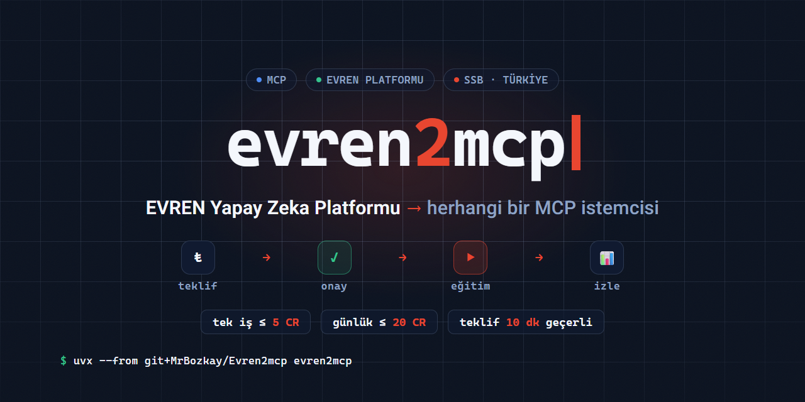

<div align="center">



# evren2mcp

**A server that connects the EVREN AI Platform to MCP clients**

Claude Code · Codex CLI · OpenCode · Cursor · VS Code · Hermes Agent

[](https://github.com/MrBozkay/Evren2mcp/actions/workflows/ci.yml)
[](LICENSE)
[](https://pypi.org/project/evren2mcp/)
[](https://modelcontextprotocol.io)

Ask *"train a small model on this dataset — how much will it cost?"* and the
client shows the price, waits for your approval, starts the job, and reports
the results and your leaderboard change.

[Türkçe](README.md) · **English**

</div>

---

> [!IMPORTANT]
> **Unofficial project.** This is an independent community project. It is not
> developed, endorsed or supported by the Presidency of Defence Industries
> (SSB) or the EVREN Yapay Zeka Platformu (EVREN AI Platform). The name
> "EVREN" is used only to describe compatibility. The server runs only with
> **your own** API key; everything it does is subject to the EVREN Platform
> User Agreement on your account. Under articles 4.9–4.11 of that agreement,
> datasets and models you upload may be used by the platform for model
> training.

## ✨ Why?

No credit-spending job starts without a quote that was shown to you and
approved by you:

- 🧾 **Quote gate** — estimated + worst-case cost before training, single-use quote valid 10 min
- 🛡️ **Dual caps** — per job ≤ 5 CR, daily ≤ 20 CR (read from the platform's own ledger)
- 🔒 **Double-charge guard** — an ambiguous POST is never retried
- 🇹🇷 **In-country** — prompts and responses are processed on the H200 cluster in Türkiye

## 📺 Example session

```text
You:    Fine-tune a small model on my drone dataset. What will it cost?
Client: (list_datasets → estimate_training)
        Quote T-51B553 — estimated 0.54 CR, worst case 1.82 CR.
        Spent today: 0 / 20 CR. Valid for 10 minutes. Start it?
You:    Yes.
Client: (start_training T-51B553) Job started: exporting data → training.
        …
Client: (get_training) Completed. Actual cost 0.14 CR, mAP50 0.356, +15 points.
```

The costs, metric and points above are from a real run on 06.10.2026; the
dialogue is abridged.

## 📦 Install

**Requirements:** [uv](https://docs.astral.sh/uv/) · any MCP client ·
an EVREN account and a **Platform** API key (panel → API keys → Platform)

Put your key in a file that only you can read, e.g. `~/.evren2mcp/.env`:

```dotenv
EVREN_PLATFORM_API_KEY=your-platform-key
```

Then register the server with your client (use the full path to the file):

### Claude Code

```bash
claude mcp add evren --scope user -e EVREN_ENV_FILE=/full/path/to/.env \
  -- uvx --from git+https://github.com/MrBozkay/Evren2mcp evren2mcp
claude mcp list   # evren … ✔ Connected
```

### Codex CLI

```bash
codex mcp add evren --env EVREN_ENV_FILE=/full/path/to/.env \
  -- uvx --from git+https://github.com/MrBozkay/Evren2mcp evren2mcp
```

### OpenCode

```bash
opencode mcp add evren --env EVREN_ENV_FILE=/full/path/to/.env \
  -- uvx --from git+https://github.com/MrBozkay/Evren2mcp evren2mcp
```

<details>
<summary><b>opencode.jsonc</b> (legacy schema; newer versions use <code>mcp.servers</code>)</summary>

```jsonc
{
  "mcp": {
    "evren": {
      "type": "local",
      "command": ["uvx", "--from", "git+https://github.com/MrBozkay/Evren2mcp", "evren2mcp"],
      "environment": { "EVREN_ENV_FILE": "/full/path/to/.env" }
    }
  }
}
```

</details>

### Cursor

`.cursor/mcp.json` (project) or `~/.cursor/mcp.json` (global):

```json
{
  "mcpServers": {
    "evren": {
      "command": "uvx",
      "args": ["--from", "git+https://github.com/MrBozkay/Evren2mcp", "evren2mcp"],
      "env": { "EVREN_ENV_FILE": "/full/path/to/.env" }
    }
  }
}
```

### VS Code

`.vscode/mcp.json`:

```json
{
  "servers": {
    "evren": {
      "type": "stdio",
      "command": "uvx",
      "args": ["--from", "git+https://github.com/MrBozkay/Evren2mcp", "evren2mcp"],
      "env": { "EVREN_ENV_FILE": "/full/path/to/.env" }
    }
  }
}
```

### Hermes Agent

```bash
hermes mcp add evren --command uvx --env EVREN_ENV_FILE=/full/path/to/.env \
  --args --from git+https://github.com/MrBozkay/Evren2mcp evren2mcp
```

<details>
<summary><b>From a local clone</b> (for development)</summary>

```bash
git clone https://github.com/MrBozkay/Evren2mcp.git && cd evren2mcp
uv sync
cp .env.example .env   # fill in EVREN_PLATFORM_API_KEY
claude mcp add evren --scope user -e EVREN_ENV_FILE=<full-path>/.env \
  -- uv run --directory <full-path> evren2mcp
```

</details>

> [!TIP]
> Ask your client *"call evren diagnostics"* to check the setup: it shows your
> settings with the key masked. On Windows use a path such as
> `C:/Users/you/.evren2mcp/.env`.

> [!NOTE]
> The `egit` and `durum` flows (prompts) appear in Claude Code's `/` menu; in
> other clients type them as a prompt. User-facing messages are in Turkish.

## 🧰 Tools

| Tool | What it does | Cost |
|---|---|:---:|
| `list_datasets` | Datasets and their versions | free |
| `search_universe` | Search public datasets/models | free |
| `get_credits` | Balance and recent ledger | free |
| `get_standing` | Points, tier, gap to the top 10 | free |
| `estimate_training` | Cost estimate + quote valid for 10 min | free |
| `start_training` | Starts training from a quote | **credits** |
| `get_training` / `list_trainings` | Status, metrics, explained errors, point change | free |
| `stop_training` | Stops a running job (irreversible) | refund |
| `evaluate_model` | Scores a model on a split | ~0.04 CR |
| `download_model` | Downloads weights (`best.pt`) | free |
| `check_dataset_zip` | Checks a zip locally; nothing is sent | free |
| `upload_dataset` | Uploads a zip to a new **private** dataset | free |
| `diagnostics` | Settings (key masked), client capabilities | free |

**Prompts:** `egit` — guided training · `durum` — balance, points, running jobs
**Resources:** `evren://kurallar` — credit earning rules · `evren://gunluk` — local training journal

## 🚦 Approval gate

```text
estimate_training ──► quote (config fingerprint, estimated/worst-case cost, 10 min)
        │
   you approve
        │
start_training(quote) ──► quote valid, unused? ──► per-job cap ──► daily cap ──► POST
                               no → reject          (worst case)  (platform ledger, UTC day)
```

1. A quote is single-use and expires in 10 minutes; quotes are wiped when the
   server restarts, so no job starts at a stale price.
2. The per-job cap is checked against the platform's worst-case estimate.
3. The daily cap reads today's spend from the platform's own ledger; open
   quotes and freshly started jobs count for 10 minutes too. Two concurrent
   calls cannot slip under the cap together.
4. If the platform gives no clear answer to a start request it is **never
   retried** (double-charge risk); the server looks the job up in the list.
5. If your client has a permission layer, it asks on each tool call (e.g.
   Claude Code).

## ⚙️ Settings

Environment variables or the file `EVREN_ENV_FILE` points to (default: `.env`
in the working directory). Process environment overrides the file.

| Variable | Default |
|---|---|
| `EVREN_PLATFORM_API_KEY` | *(required)* |
| `EVREN_ENV_FILE` | `./.env` |
| `EVREN_PROJECT_ID` | first project |
| `EVREN_MAX_JOB_CR` | `5` |
| `EVREN_MAX_DAILY_CR` | `20` |
| `EVREN_JOURNAL_PATH` | `~/.evren2mcp/journal.jsonl` |
| `EVREN_DOWNLOAD_DIR` | `~/.evren2mcp/models` |
| `EVREN_MAX_UPLOAD_MB` | `2048` |

## 🔐 Security & privacy

- The key travels only over HTTPS to the API domain; never to download links
  on other domains. It is masked in every output and error message.
- Requests are rate-limited to 20/min with burst smoothing; the platform's own
  rate limit is never bypassed (the terms forbid it).
- The training journal and downloaded models stay on your machine.
- See [SECURITY.md](SECURITY.md) for responsible disclosure.

## 🚫 Deliberately absent

Deletion, making things public, labelling, accepting terms, key management.
Those stay with the user in the panel.

## 🛠️ Development

Contributing: [CONTRIBUTING.md](CONTRIBUTING.md) · Design:
[docs/tasarim.md](docs/tasarim.md) (TR) · Measured platform behaviour:
[docs/canli-dogrulama.md](docs/canli-dogrulama.md) (TR)

```bash
git clone https://github.com/MrBozkay/Evren2mcp.git && cd evren2mcp
uv sync
uv run pytest -q        # 124 tests
uv run ruff check src tests
uv run mypy
```

## 📄 License

[MIT](LICENSE) — © 2026 MrBozkay

---

<div align="center">

**EVREN AI Platform** · sign in with e-Devlet: [evren.ssyz.org.tr](https://evren.ssyz.org.tr)

</div>
